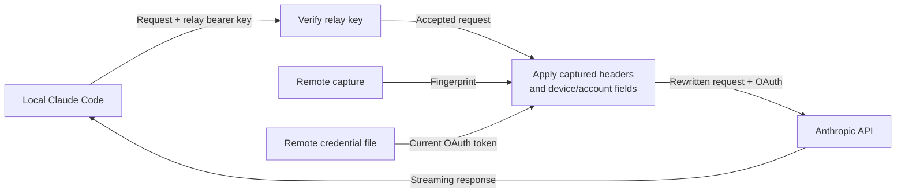

# cchop

cchop is a personal Claude Code subscription relay distributed as a global npm CLI. It implements the two-stage design in [the source document](https://bytedance.larkoffice.com/wiki/OkVnw34DTilaLMkaUI5ceE7enbf): capture the remote Claude Code request identity once, then run a relay that rewrites incoming requests and owns the remote OAuth refresh lifecycle. `cchop start` runs the relay and its bundled operations dashboard in one foreground process.

The local client holds only the relay URL and shared relay key. Subscription credentials stay on the relay host. Configuration, captured identity, and secrets live outside the npm installation directory. A Dockerfile bundles both CLIs, and an optional Helm chart deploys one persistent instance. Cluster administration and provider login remain operator responsibilities.

## Install

Requires Node.js **22.19 or newer** and npm. Capture also requires an installed, logged-in Claude Code client on the relay host. The document uses the Linux credential file; cchop requires that file format and does not read the macOS Keychain.

Install the CLI and bundled dashboard from npm:

```bash
npm install -g cchop
cchop --version
```

Installation does not start services or modify Claude credentials. To install from a source checkout instead:

```bash
npm ci
npm run check
npm pack
npm install -g ./cchop-0.1.0.tgz
```

## Docker

Build from this checkout, including the bundled dashboard:

```bash
docker build --pull -t cchop:local .
docker run --rm cchop:local cchop --version
docker run --rm cchop:local claude --version
```

The [Dockerfile](Dockerfile) pins the current [official Node slim image](https://hub.docker.com/_/node) at Node **26.12.0**, Debian trixie, with its multi-platform digest, and installs Claude Code **2.1.301** from [Anthropic's npm package](https://code.claude.com/docs/en/setup#install-with-npm). cchop is compiled from the checkout with locked production dependencies. Build tools and source code stay out of the final image. The [Docker Hub workflow](#docker-hub-publishing) builds and smoke-tests amd64 and arm64 on native runners, then publishes one image supporting both architectures.

The image runs as `node` (UID/GID 1000) and defaults to `cchop start`, with Tini forwarding shutdown signals. Mount a named volume at **`/home/node`** for Claude's `.claude/` and `.claude.json`, plus cchop's `.config/cchop/`. Keep that entire volume private. For a bind mount instead, prepare an empty directory writable by UID/GID 1000; do not mount your normal home directory. Do not share the volume between running relay instances or run Claude while the relay owns the credentials.

For first-time setup, start an interactive shell with the persistent volume:

```bash
docker volume create cchop-home
docker run --rm -it --name cchop-setup \
  --mount type=volume,source=cchop-home,target=/home/node \
  cchop:local bash
```

Inside that container, initialize and log in, then start capture:

```bash
cchop init
claude auth login
cchop capture
```

Follow the login URL in your host browser and complete the CLI's prompts. While capture is listening, use a **second host terminal** to run Claude in the same container:

```bash
docker exec -it cchop-setup env \
  -u ANTHROPIC_AUTH_TOKEN -u ANTHROPIC_API_KEY -u ANTHROPIC_CUSTOM_HEADERS \
  ANTHROPIC_BASE_URL=http://127.0.0.1:9999 claude
```

Send a short message, wait for capture to finish, then exit Claude. Capture remains on container loopback; port 9999 is never published. In the first terminal, run `cchop doctor --offline`, then `exit` to remove the setup container. Its volume remains.

Start the relay in the foreground:

```bash
docker run --rm --name cchop --stop-timeout 45 \
  --mount type=volume,source=cchop-home,target=/home/node \
  -p 127.0.0.1:8787:8787 -p 127.0.0.1:8788:8788 \
  cchop:local
```

Both listeners bind `0.0.0.0` **inside** the container via environment overrides; these port mappings restrict access to host loopback. The dashboard is at `http://127.0.0.1:8788`, with its key in `/home/node/.config/cchop/credentials.env`. Configure your own HTTPS ingress for remote relay access. Stop with Ctrl+C or `docker stop cchop`; the 45-second stop timeout allows the default 30-second drain to finish.

To generate and copy private client settings, use another host terminal while the relay is running:

```bash
docker exec cchop cchop client --url https://cchop.example.com --output /home/node/claude.settings.json
docker cp cchop:/home/node/claude.settings.json ./claude.settings.json
chmod 600 ./claude.settings.json
```

Substitute your actual relay URL; use `http://127.0.0.1:8787` for a client on the Docker host. Transfer this file privately as described below. The command refuses to overwrite an existing settings file.

`NODE_IMAGE` and `CLAUDE_CODE_VERSION` are build arguments for explicit upgrades. Update the pinned defaults (including the Node digest), rebuild, stop the relay, and repeat the setup shell's capture step with `cchop capture --replace` using the existing volume; do not rerun `init`. Claude's automatic and manual updater commands are disabled with `DISABLE_AUTOUPDATER=1` and `DISABLE_UPDATES=1`, so installed binaries remain part of the image. Never bake login state or cchop secrets into an image. Docker Hub publication uses its own workflow, separate from npm releases.

## Kubernetes with Helm

The [cchop chart](helm/cchop/README.md) follows the Argus chart repository layout:

```bash
helm repo add cchop https://kr4t0n.github.io/cchop/helm
helm repo update cchop
helm show values cchop/cchop --version 0.1.0
```

The chart pins a published amd64/arm64 image and runs one replica with `Recreate` updates, a retained private home PVC, separate relay/admin Services, and optional independent ingresses. Start a fresh install with `setup.enabled=true` to log in and capture inside the idle pod; Services exclude setup pods. Exit Claude before switching to relay mode. The [operator guide](helm/cchop/README.md#install-and-capture) provides exact rendering, installation, capture, verification, and rollback commands. A [Tailscale example](helm/cchop/examples/values.tailscale.yaml) exposes the relay and dashboard on separate tailnet names.

Automated chart checks and publication never access a cluster. Apply the reviewed manifests yourself; the chart creates only its release's workload, storage claim, Services, and optional ingresses. It does not install an ingress controller, manage the cluster, or automate Claude login.

## First-time setup on the relay host

Create cchop configuration and independent random relay/dashboard keys:

```bash
cchop init
```

By default this creates `~/.config/cchop/cchop.json` and the private sibling `credentials.env`. If `XDG_CONFIG_HOME` is set, its `cchop` directory is used instead. `init` prints their locations and refuses to overwrite existing files.

Log in to your subscription using the remote Claude Code installation, with relay overrides removed from that shell:

```bash
env -u ANTHROPIC_BASE_URL -u ANTHROPIC_AUTH_TOKEN -u ANTHROPIC_API_KEY -u ANTHROPIC_CUSTOM_HEADERS claude auth login
```

The [Claude Code CLI reference](https://code.claude.com/docs/en/cli-reference) documents this login command. cchop expects `~/.claude/.credentials.json`, containing `claudeAiOauth.accessToken`, `refreshToken`, and millisecond `expiresAt`. It also reads optional `clientId`, `scopes`, and millisecond `refreshTokenExpiresAt` fields. For a different location, use `cchop init --credentials /absolute/path/to/.credentials.json`, or configure the path afterwards. In particular, point cchop explicitly at the matching file if Claude Code uses `CLAUDE_CONFIG_DIR`; see [Claude credential storage](https://code.claude.com/docs/en/authentication#credential-management).

Keep any recovery backup private and outside the project. A backup containing an already-rotated refresh token may no longer authenticate; a fresh remote login is the recovery path when credentials cannot be refreshed.

## Capture once

With the relay stopped, run:

```bash
cchop capture
```

This listens only on `127.0.0.1:9999` and prints a command to run in a second terminal on the **same relay host**:

```bash
env -u ANTHROPIC_AUTH_TOKEN -u ANTHROPIC_API_KEY -u ANTHROPIC_CUSTOM_HEADERS ANTHROPIC_BASE_URL=http://127.0.0.1:9999 claude
```

Send a short message. Capture records the first valid `/v1/messages` request's reusable headers, device/account identity, timestamp, and capture process Node version in fingerprint format `schemaVersion: 2`. It parses the JSON string in `metadata.user_id` and stores only `device_id` and `account_uuid` in the fingerprint's `identity` object.

The device ID must be a nonempty string; the account UUID must be a string and may be empty, as emitted by clients without a cached account profile. Use a current Claude Code client; opaque legacy user IDs, malformed identities, and conflicting session IDs are rejected before forwarding. When both are present, `x-claude-code-session-id` must match `metadata.user_id.session_id`.

Capture excludes authorization, cookies, transport headers, the prompt body, other user-ID fields, and every `x-claude-code-*` header. The original request is forwarded upstream with its original OAuth authorization and per-request headers, and its response streams back unchanged. Capture exits after that exchange. An upstream failure is reported even if the fingerprint was saved.

Exit the remote Claude Code session before starting the relay. Once the relay is running, it must be the only process refreshing that credential file. Use one person, one subscription, and one relay instance, as prescribed by the document.

After upgrading the remote Claude Code installation, stop the relay and repeat `cchop capture --replace`. Replacement is atomic. Capture never overwrites an existing fingerprint unless `--replace` is given. Align the relay's Node major version with capture; startup and diagnostics warn when they differ. This version check does not establish TLS fingerprint equivalence.

Existing unversioned and version-1 fingerprints require recapture. `cchop start` rejects unsupported fingerprint formats, and `cchop doctor --offline` reports the same migration instructions. Stop the relay, run `cchop capture --replace` with a current remote Claude Code client, exit that client, then run `cchop doctor --offline` before restarting. Do not change an old fingerprint's version by hand: a fresh capture extracts the device/account fields and excludes session and request correlation data.

## Start and connect

On the relay host, check the captured identity and credentials, then generate local client settings:

```bash
cchop doctor --offline
cchop client --url https://cchop.example.com --output ./claude.settings.json
cchop start
```

The relay defaults to `127.0.0.1:8787`. Use `cchop start --host 0.0.0.0` to bind all IPv4 interfaces. The dashboard defaults to `http://127.0.0.1:8788`; sign in with `CCHOP_ADMIN_TOKEN` from the private `credentials.env` file. The CLI prints the file path, never either key.

Privately copy the generated settings to the **local client machine**, then run:

```bash
claude --settings ./claude.settings.json
```

The file sets exactly `ANTHROPIC_BASE_URL` and `ANTHROPIC_AUTH_TOKEN`. The latter is the cchop shared key, not an Anthropic token. No local subscription login is used for relay requests. The remote OAuth tokens are never included. For a same-host check, generate settings with `--url http://127.0.0.1:8787`.

The settings file is owner-only and is never silently overwritten. Existing Claude settings are not edited. Remove conflicting API-key, custom-header, or alternate-provider overrides from your client setup. A base URL controls supported API requests; login and auxiliary network endpoints may be separate.

`cchop start` stays in the foreground. Ctrl+C or SIGTERM stops accepting work, drains active requests until the configured deadline, cancels remaining network work, and closes both listeners. An already-received token rotation finishes its atomic credential commit before exit. Run configuration commands in another terminal while it is active.

## Request mechanism



1. Compare the incoming bearer key using SHA-256 and constant-time comparison. Reject invalid or duplicate authentication headers before reading credentials or contacting the provider.
2. Strip local `user-agent`, `x-app`, `anthropic-version`, `anthropic-beta`, `sec-fetch-mode`, all `x-stainless-*`, provider credentials, gateway headers, and hop-by-hop/forwarding headers. Apply the captured reusable headers. Pass through the client's `x-claude-code-session-id`, `x-claude-code-agent-id`, `x-claude-code-parent-agent-id`, and `x-claude-code-prompt-id` when present; absent headers stay absent. Other `x-claude-code-*` request hints, including request class, agent type, compaction state, and tool durations, also pass through from the current request. None are replayed from the capture.
3. When `metadata.user_id` exists, parse its JSON-encoded object, replace only `device_id` and `account_uuid` with captured values, and serialize it back to a string. Preserve the client's `session_id`, every other user-ID field, and the rest of the request. Missing metadata or a missing user ID stays absent. Session header/body values must match when both exist; malformed identities and conflicting sessions return **400** before credential refresh or inference. Invalid JSON, invalid metadata, and compressed request bodies are rejected; content length is recalculated from the rewritten bytes.
4. Read the remote credential file for every request. Within five minutes of access-token expiry, refresh through the configured token endpoint. Use the stored `claudeAiOauth.clientId` when present, otherwise `oauthClientId`; send stored nonempty `scopes` as a space-delimited `scope` without adding new grants. One in-process promise serializes refreshes. Persist the new access token and expiry together with the returned refresh token, or retain the existing refresh token when the response omits it. Update `scopes` from a supplied `scope` and `refreshTokenExpiresAt` from a supplied `refresh_token_expires_in` (seconds converted to an absolute millisecond timestamp); omitted fields retain their stored values. Commit all fields through one owner-only temporary file and atomic rename, preserving unrelated metadata. A failed refresh or persistence returns **503**, without forwarding an inference request or returning an unpersisted access token.
5. Send the rewritten request with the remote OAuth bearer token using Node.js and undici. Stream the response with backpressure. Client disconnection cancels upstream work. Inference requests are never automatically retried; redirects are rejected.

OAuth responses may omit a replacement refresh token, scope, or refresh-token expiry. Explicit malformed values, including a null or empty replacement refresh token, are rejected without modifying the credential file. An explicitly empty `scope` clears the stored scope list; a zero refresh-token lifetime records expiry at response processing time. Legacy credential files without optional metadata remain supported: the configured client ID is used and `scope` is omitted when no stored scopes are available. Stored optional fields must have valid types.

Device/account identity comes from capture; session and execution correlation remain with the current client. No session mapping state is needed, so distinct sessions stay distinct and resumed sessions keep their IDs across relay restarts. Captured capability headers remain fixed: changes in the local client's capability headers are not merged into the recorded fingerprint. Re-capture after remote client upgrades. cchop does not claim that rewriting identity prevents account enforcement or proves equivalence with the remote client's TLS handshake.

## Commands

| Command | Purpose |
| --- | --- |
| `cchop init` | Create configuration and relay/admin keys |
| `cchop capture [--port 9999] [--replace]` | Capture one remote request on loopback |
| `cchop start` | Start subscription relay and dashboard |
| `cchop doctor [--offline] [--json]` | Inspect configuration, fingerprint, runtime, credentials, and optional connectivity; never refresh tokens or send inference |
| `cchop client --url <origin> --output <file>` | Generate private local client settings |
| `cchop --config <path> <command>` | Select a different configuration file |

`start` accepts listener overrides `--host`, `--port`, `--admin-host`, and `--admin-port`. `--quiet` disables per-request metadata logs; sanitized fingerprint/runtime/refresh diagnostics remain available. Use each command's `--help` for its options.

## Configuration and secrets

`CCHOP_CONFIG` or `--config` selects the configuration file. cchop reads `credentials.env` beside it; process environment variables take precedence. It does not load arbitrary working-directory `.env` files. Relative fingerprint and Claude credential paths resolve against the configuration directory.

| Variable | Meaning |
| --- | --- |
| `CCHOP_GATEWAY_TOKEN` | Shared relay bearer key, 24–256 characters |
| `CCHOP_ADMIN_TOKEN` | Independent dashboard key, 24–256 characters |
| `CCHOP_CONFIG` | Configuration path |
| `CCHOP_FINGERPRINT` | Captured fingerprint path |
| `CCHOP_CLAUDE_CREDENTIALS` | Remote Claude OAuth credential JSON path |
| `CCHOP_HOST`, `CCHOP_PORT` | Relay listener overrides |
| `CCHOP_ADMIN_HOST`, `CCHOP_ADMIN_PORT` | Administration listener overrides |
| `CCHOP_UPSTREAM` | Upstream API origin |
| `CCHOP_PUBLIC_URL` | Relay origin for generated settings |
| `CCHOP_OAUTH_TOKEN_URL`, `CCHOP_OAUTH_CLIENT_ID` | Token endpoint and fallback OAuth client ID; a stored credential `clientId` takes precedence |

See [.env.example](.env.example). OAuth access and refresh tokens are read from the configured Claude credential file, not cchop environment variables.

| JSON field | Default | Purpose |
| --- | --- | --- |
| `host` / `port` | `127.0.0.1` / `8787` | Relay listener |
| `adminHost` / `adminPort` | `127.0.0.1` / `8788` | Separate dashboard listener |
| `upstream` | `https://api.anthropic.com` | API destination |
| `publicUrl` | `null` | Optional public relay origin |
| `authMode` | `subscription` | Document's remote subscription design |
| `fingerprintPath` | `fingerprint.json` | Relative to configuration directory |
| `claudeCredentialsPath` | `~/.claude/.credentials.json` as an absolute path | Remote credential file |
| `oauthTokenUrl` | `https://platform.claude.com/v1/oauth/token` | Token refresh endpoint from the document |
| `oauthClientId` | `9d1c250a-e61b-44d9-88ed-5944d1962f5e` | Fallback public OAuth client ID; stored credential `clientId` takes precedence |
| `maxRequestBytes` | `33554432` | Body bound before and after rewriting |
| `maxConcurrent` | `32` | Concurrent authenticated relay requests |
| `headersTimeoutMs` | `60000` | Upstream header timeout |
| `streamIdleTimeoutMs` | `360000` | Maximum silence between upstream response chunks |
| `shutdownGraceMs` | `30000` | Maximum drain time |
| `recentRequestsLimit` | `100` | Retained request metadata per process |

External API origins and OAuth endpoints require HTTPS. HTTP is allowed only for loopback tests. Relay and admin ports/keys must differ. Fingerprint, configuration, gateway credentials, and Claude credentials must use distinct paths. Restart after rotating relay/admin keys or replacing a fingerprint. OAuth credentials are reread automatically.

## Migrating the earlier proxy build

The previous `passthrough` and `api-key` behaviors have been removed. Existing configurations with those modes fail with a migration message; cchop does not silently change their authentication. Stop that process, set `authMode` to `subscription`, configure the remote credential and fingerprint paths, perform capture, and regenerate client settings at a new path. Remove the old `X-Cchop-Key` custom-header configuration. Existing relay/admin keys may be retained.

## Development and verification

```bash
npm ci
npm run check
npm run test:package
npx playwright install chromium
npm run test:browser
docker build --pull -t cchop:local .
npm run test:docker
npm run test:helm  # requires Helm 3.20+; CI pins 3.22.1
```

`npm run check` runs ESLint, server/UI type checks, both builds, and protocol/CLI tests. `npm run test:package` installs the tarball globally into a temporary prefix and exercises the actual installed capture, startup, client, dashboard, streaming, and shutdown flow. It leaves the current tarball in this checkout and removes its temporary installation. Browser checks cover real local service metrics, authentication, polling, filtering, offline behavior, and desktop/mobile layout. An existing Chromium can be selected with `PLAYWRIGHT_CHROMIUM_EXECUTABLE`.

`npm run test:docker` checks the built image (or pass another tag with `npm run test:docker -- <image>`): both CLIs, non-root volume ownership, capture, OAuth refresh persistence, request rewriting, bundled dashboard, default startup, and SIGTERM shutdown. It creates and removes a temporary Docker volume and runs containers with networking disabled; mock provider traffic stays on container loopback. The containers also use the chart's read-only root filesystem, writable `/tmp`, dropped capabilities, and no privilege escalation.

`npm run test:helm` lints and renders the default, setup, existing-storage/Secret, and Tailscale configurations; checks one-process ownership and setup traffic isolation; rejects invalid values; and tests immutable chart archives and retained version history. It uses temporary local files and no cluster access. The Helm workflow runs these checks on relevant pull requests and before publication.

All automated checks use temporary fake fingerprints, generated test credentials, and loopback API/OAuth servers. They do not read the operator's credential store or make real subscription requests. Successful mock checks establish implementation behavior; live remote login, capture, and provider compatibility still require operator validation. Tests supervise and close their temporary services in the foreground. The CI workflow runs lint, types, tests, builds, and package/browser checks. The Docker Hub workflow also runs application checks and container smoke tests on native amd64 and arm64 runners; relevant pull requests build and test without publishing.

For dashboard development, first build and start cchop, then run `npm run dev --workspace @cchop/web` in another terminal. Vite forwards `/api` to the default local admin port.

## Releasing

Keep the version in the root and web package manifests, lockfile, `src/config.ts`, and the installed-version assertion in `scripts/package-smoke.ts` aligned. Update versioned installation examples when releasing a new version.

### Docker Hub publishing

The [Publish to Docker Hub workflow](.github/workflows/docker-publish.yml) publishes `<DOCKERHUB_USERNAME>/cchop`. Configure these repository secrets under **Settings → Secrets and variables → Actions**:

| Secret | Value |
| --- | --- |
| `DOCKERHUB_USERNAME` | Docker Hub account owning the `cchop` repository, normally `kr4t0n` |
| `DOCKERHUB_TOKEN` | Docker Hub access token with Read & Write permission for that repository |

Create the Docker Hub repository first and make it public if anonymous pulls are intended. Supply the token through GitHub's secret settings; never put it in source, build arguments, or workflow YAML.

| Trigger | Docker Hub result |
| --- | --- |
| Push to `main` | `latest`, `main`, `sha-<short commit>` |
| Push a stable version tag, such as `v0.2.0` | `latest`, `v0.2.0`, `0.2.0`, `0.2`, `sha-<short commit>` |
| Manual run with **push** enabled (the default) | Tags for the selected branch/tag, plus `manual-<run_id>` and the commit tag |
| Manual run with **push** disabled | Build and test both architectures; no registry login or publication |
| Pull request targeting `main` that changes image inputs or checks | Build and test both architectures; no registry login or publication |

Version tags must match the stable version in the package manifests, lockfile, and CLI. Prerelease and mismatched version tags fail validation. `latest` follows completed main-branch and stable-tag publications; use a version or commit tag when you need a particular build. Publishing a GitHub release is not required for Docker images; npm publication still requires the separate release event described below.

Each architecture builds on a native GitHub-hosted runner (`ubuntu-latest` for amd64 and `ubuntu-24.04-arm` for arm64), with a separate BuildKit cache. The workflow runs `npm run check`, loads the image, and runs `npm run test:docker` before pushing that architecture by digest. Once both jobs pass, it assembles the tags from those digests and verifies that every tag contains the expected amd64 and arm64 manifests. A failed architecture prevents tag publication; an already-uploaded untagged digest may remain. Runs on the same Git ref cancel older in-progress runs. Forks never publish.

After the first successful publication, use the published image in place of `cchop:local` in the setup commands above, for example:

```bash
docker pull kr4t0n/cchop:main
docker run --rm kr4t0n/cchop:main cchop --version
docker run --rm kr4t0n/cchop:main claude --version
```

Replace `kr4t0n` if a different Docker Hub account is configured. Pulling an image does not initialize state or log in to Claude; reuse the documented setup/capture flow and private home volume. A local image build or a manual build-only run does not establish Docker Hub availability; inspect the publish workflow's manifest verification before announcing a release.

### Helm chart publishing

The [Helm publishing workflow](.github/workflows/helm-publish.yml) publishes chart packages and `index.yaml` to **https://kr4t0n.github.io/cchop/helm**, with version history stored on `gh-pages`. Configure **Settings → Pages → Source: GitHub Actions** once. It uses the repository's `GITHUB_TOKEN`; no additional secret is needed.

Pushes to `main` affecting the chart, its packaging/check scripts, dependencies, or workflow validate and publish. Manual runs can publish from `main` or validate only; pull requests never publish. Bump `helm/cchop/Chart.yaml`'s `version` for every packaged change. Identical republishing preserves the original bytes, changed contents at an existing version fail, and older versions remain downloadable. Chart versioning is separate from npm/Docker releases; update the default image only after its Docker publication succeeds.

Publication serializes writes, creates `gh-pages` when absent, packages without replacing released archives, explicitly deploys a Pages artifact, and verifies a public Helm download against the archived package. It never runs `helm install`, `helm upgrade`, or Kubernetes commands. See the [chart guide](helm/cchop/README.md) for operator deployment and upgrade steps.

### npm publishing with GitHub Actions

The [Publish to npm workflow](.github/workflows/publish.yml) runs when a stable GitHub release is published. It checks out that release's tag, checks that `v<version>` matches the package and CLI versions, runs lint, types, builds, protocol/CLI tests, and package/browser smoke checks, then publishes the tested tarball with provenance. It verifies that npm serves the same artifact. Prereleases are skipped. Concurrent publishing runs are serialized.

Configure the package's [npm trusted publisher](https://docs.npmjs.com/trusted-publishers/) once in [npm package settings](https://www.npmjs.com/package/cchop/access):

| Setting | Value |
| --- | --- |
| Provider | GitHub Actions |
| Organization or user | `kr4t0n` |
| Repository | `cchop` |
| Workflow filename | `publish.yml` |
| Environment | Leave empty |
| Allowed actions | Enable direct publishing with `npm publish` |

The workflow uses GitHub-hosted runners and OIDC authentication. No `NPM_TOKEN` GitHub secret is needed. The pinned npm CLI supports trusted publishing. With npm 11.15 or newer, the same trust connection can be configured using `npm trust github cchop --repo kr4t0n/cchop --file publish.yml --allow-publish --yes`; npm may require browser verification.

For each release, commit and push the version changes, wait for CI, create and push a `v<version>` tag on that commit, then publish its GitHub release. Publishing the GitHub release authorizes npm publication. Inspect the workflow result before announcing availability. Each release needs a new npm version; the published `0.1.0` cannot be reused. A failed workflow can be rerun after correcting authentication, provided its version has not already been published.

Use **Actions → Publish to npm → Run workflow** to validate the selected ref without publishing. Manual runs execute all checks and a publish dry run; they do not exercise npm's OIDC publication authorization. Pushing a commit or tag alone does not publish a package.

### Manual publishing fallback

Run `npm run check`, `npm run test:package`, and `npm run test:browser`. The package smoke check creates and tests the release tarball. Inspect it with `npm publish ./cchop-<version>.tgz --dry-run`, commit the release changes, and publish that same tarball with `npm publish ./cchop-<version>.tgz --access public` from an authenticated npm account. Replace `<version>` with the release version. Verify the registry integrity and install the published version in a temporary prefix before announcing it. Publishing a GitHub release afterwards also triggers the workflow, which will fail when attempting to republish that existing version; prefer the automated path for normal releases.

## Project structure

| Path | Responsibility |
| --- | --- |
| `src/cli.ts`, `src/config.ts`, `src/doctor.ts` | Commands, configuration, diagnostics |
| `src/capture.ts`, `src/fingerprint.ts` | Loopback capture and private fingerprint persistence |
| `src/identity.ts` | Device/account schema, nested identity parsing, and session consistency validation |
| `src/rewriter.ts` | Captured identity substitution |
| `src/credentials.ts` | Disk-backed OAuth credentials, serialized refresh, atomic rotation |
| `src/server.ts`, `src/security.ts` | Relay transport, listener isolation, authentication, header filtering |
| `src/metrics.ts`, `src/types.ts` | Bounded operational history and dashboard contract |
| `web/` | React/TypeScript/Tailwind operations dashboard |
| `test/`, `scripts/` | Protocol/CLI tests and package/browser/Docker smoke checks |
| `Dockerfile`, `.dockerignore` | Slim Node image with Claude Code and source-built cchop; restricted build context |
| `helm/cchop/` | Single-instance Helm chart, setup mode, persistence, ingress examples, and operator guide |
| `scripts/helm-*.ts` | Local chart checks and immutable repository packaging |
| `.github/workflows/ci.yml` | Application verification |
| `.github/workflows/docker-publish.yml` | Native amd64/arm64 checks and Docker Hub publication |
| `.github/workflows/helm-publish.yml` | Chart validation and GitHub Pages repository publication |
| `.github/workflows/publish.yml` | Stable-release npm publishing and manual validation |

The relay serves messages, token counting, models, and the connection-warming probe. Logs contain request metadata and sanitized capture/refresh diagnostics, never prompts, OAuth tokens, gateway keys, or `metadata.user_id`. Request history is bounded and in memory; restarting clears it. Dashboard credentials stay only in browser memory. No account pooling, credential sharing service, or cluster administration is included.
